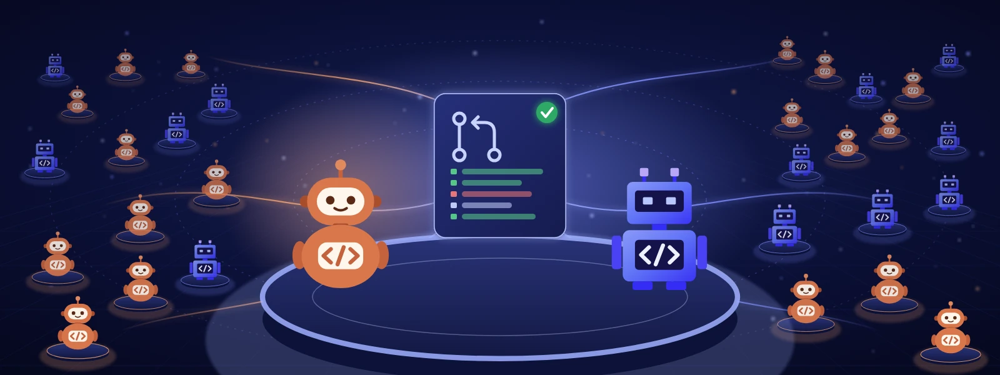
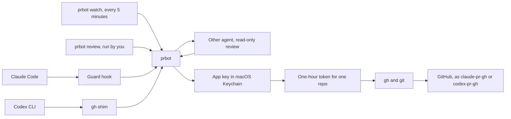

<p align="center">
  
  
  
  
</p>

# pr-review-bots

Two GitHub Apps, and the tooling around them, so that PR feedback written by Claude or Codex is posted as `claude-pr-gh[bot]` or `codex-pr-gh[bot]` instead of under Kenny's own account. A reader of any PR can then tell at a glance which comments a person wrote and which ones an agent wrote.

Everything runs locally through one command, `prbot`. It signs in as the right App, gets a token that lasts one hour and works on one repository, and runs `gh` with it. It also routes reviews: Codex reviews what Claude wrote, and Claude reviews what Codex wrote, unless you say otherwise. [`DESIGN.md`](DESIGN.md) explains the reasoning behind each choice.

## Project status

Both Apps are registered and installed on all of `kennylhilljr`'s repositories, and both have posted through `prbot` on [openclaw-ecc-orchestrator](https://github.com/kennylhilljr/openclaw-ecc-orchestrator).

| Piece | Status |
| --- | --- |
| `claude-pr-gh` and `codex-pr-gh` Apps | Live. Keys in macOS Keychain. |
| `prbot gh` (post as a bot) | Working. |
| `prbot review` with Claude reviewing | Working; posted a review on PR 20. |
| `prbot review` with Codex reviewing | Built, but not yet seen end to end. The first run stopped at a Codex usage limit. |
| Claude Code guard hook | Installed and blocking direct posts. |
| Codex CLI `gh` shim | Built and tested locally; not yet used in a live Codex session. |
| `prbot watch` (automatic reviews) | Live: launchd runs it every 5 minutes across all 21 repos. |
| `prbot watch --from-queue` (event-driven reviews) | Built and tested; the queue job and hourly backstop in `integrations/launchd/` are not installed yet. |
| `cross-review` skill | Linked into `~/.claude/skills` and `~/.codex/skills`. |
| `prbot git` (push as a bot) | Live for both bots, with Contents write. |
| OpenClaw | Reviews with P1 or P2 findings appear in OpenClaw as `attention.required` under the `github` run, written through the orchestrator runtime's event writer. Skipped quietly if the runtime is not installed. |
| Backup review (GitHub Actions) | Built; not installed on any repo yet. See [Backup review when the Mac is offline](#backup-review-when-the-mac-is-offline). |

## Architecture



Reads such as `gh pr view` and `gh pr diff` always use your normal `gh` login. Only posts go through a bot.

## Requirements

| Dependency | Required | Purpose |
| --- | --- | --- |
| Python 3.9 or newer | Yes | Runs `prbot`, the guard hook and the tests. |
| `gh` (GitHub CLI) | Yes | Every read and post goes through it. Log in with `gh auth login`. |
| `openssl` | Yes | Signs the App login (RS256). |
| macOS Keychain (`security`) | Recommended | Holds the App private keys. Other systems fall back to a mode-600 file in `~/.config/prbot/`. |
| `claude` CLI | For Claude reviews | `prbot review` runs it read-only. |
| `codex` CLI | For Codex reviews | `prbot review` runs it with `-s read-only`. |

There are no third-party Python packages. The tests use the standard-library `unittest` runner.

## Install and run locally

Clone the repository into `~/Documents/GitHub`, which is where the Claude Code hook below expects it, and put `prbot` on your PATH:

```bash
git clone https://github.com/kennylhilljr/pr-review-bots.git ~/Documents/GitHub/pr-review-bots
```

```bash
ln -s ~/Documents/GitHub/pr-review-bots/prbot ~/.local/bin/prbot
```

Run the tests before first use:

```bash
cd ~/Documents/GitHub/pr-review-bots && python3 -B -m unittest discover -s tests -t . -v
```

### Register the Apps (once)

`register` opens a local page that sends the App definition to GitHub. You confirm the name on GitHub's page, GitHub sends you back, and the private key goes straight into Keychain. No key file is downloaded.

```bash
prbot register claude
```

```bash
prbot register codex
```

If GitHub says a name is taken, change it on GitHub's form or edit `name` in `bots/<bot>.json` first. Then install each App on your repositories and upload its logo from `logos/` on the App's settings page; GitHub has no API for logos.

```bash
prbot install-url claude
```

Check that each App can sign in and sees its installations:

```bash
prbot whoami claude
```

### Post as a bot

Put prbot's own options before `--`, and the `gh` command after it:

```bash
prbot gh claude -R kennylhilljr/openclaw-ecc-orchestrator -- pr comment 15 --body-file review.md
```

Without `-R`, prbot uses the `origin` remote of the current directory.

### Push as a bot

Agent commits and pushes should show the bot, not you. `prbot git` sets the bot as author and committer (`claude-pr-gh[bot] <349557468+claude-pr-gh[bot]@users.noreply.github.com>`), which is what makes GitHub show the bot and its logo on the commit. For push, fetch and pull it also supplies a one-hour token with contents write, which needs the App's **Contents** permission set to read and write.

```bash
prbot git claude -- commit -m "Fix the thing"
```

```bash
prbot git claude -- push origin main
```

The token reaches `git` through a credential helper that reads it from the environment, so it never lands in git config or on disk. Do not use `Claude <noreply@anthropic.com>` as the author: GitHub links that email to Anthropic's own `claude` account.

### Review a PR with the other agent

```bash
prbot review 18 -R kennylhilljr/openclaw-ecc-orchestrator --route-only
```

`--route-only` prints who wrote the PR and who will review it, without running a model or posting. Drop it to run the review and post it; use `--dry-run` to run the review and print it instead. Run from a checkout of the repository when you can, so the reviewer can read files beyond the diff.

How the reviewer is chosen:

1. `--reviewer claude|codex|both` on the command line.
2. A `review:claude` or `review:codex` label on the PR.
3. Otherwise the other agent. The author comes from an `agent:claude` or `agent:codex` label, or else from commit authors and `Co-Authored-By` trailers.

If the author is unclear and nothing names a reviewer, prbot posts nothing and exits with code 3.

### Review new commits automatically

`prbot watch` makes one pass over every open, non-draft PR on every repository the bots are installed on. Each new commit gets a review from the other agent, once.

`prbot watch --from-queue DIR` does the same for only the PRs named in GitHub event files in `DIR`. OpenClaw's GitHub event router writes one JSON file per PR event into `~/.local/state/github-events/prbot/`, and a launchd job with `QueueDirectories` starts a queue run as soon as one lands. A second launchd job runs the full pass every hour to catch anything the events missed. [`integrations/launchd/README.md`](integrations/launchd/README.md) has the two plists with install and rollback steps. The older `install-watch.sh` still installs a single job that runs the full pass every 5 minutes:

```bash
~/Documents/GitHub/pr-review-bots/integrations/launchd/install-watch.sh
```

How a pass behaves:

- It finds earlier reviews from the "Reviewed commit" line in each bot review, so it never reviews the same commit twice, even after a restart.
- It runs at most 3 reviews per pass; the rest wait for the next pass.
- A PR it can't attribute is skipped and logged once, with the command to review it by hand. Its labels are read again on every run, so adding `agent:claude` or `agent:codex` later starts the review without a new commit.
- A review that fails, for example on a usage limit, is retried an hour later.
- A review that runs longer than 900 seconds is stopped, along with every process it started, and counts as failed, so one stuck reviewer cannot hold up the PRs behind it. Set `PRBOT_REVIEW_TIMEOUT` (whole seconds) to change the limit. `prbot watch` and `prbot review` check it when they start and exit 2 with a message naming the variable if it is not a positive whole number; other commands ignore it.
- Only one watch run works at a time. A run that finds the lock (`~/.config/prbot/watch.lock`) taken logs that and exits 0 without looking at the queue. A queue run holds the lock from checking the queue directory to its last move, and the hourly pass holds it until it has moved the deferred files back, so the queue job launched by those files waits for its next relaunch.

How a queue run treats the files:

- prbot only works on a queue directory that is `~/.local/state/github-events/prbot` itself or whose parent holds a regular file named `.github-events-queue`, which the event router creates. Anything else, a `DIR` that is a symlink, or a path that is not a directory, is refused with exit 2 and nothing is moved. This keeps a mistaken `--from-queue .` from emptying a checkout. The hourly pass applies the same check to `PRBOT_QUEUE_DIR` before moving deferred files back; when it refuses, the pass still runs and the command exits 2. The same refusal applies when `DIR-deferred` or `DIR-rejected` exists but is not a real directory (a symlink or a file).
- Several events for the same PR are handled as one, oldest file first.
- A sweep event, a file such as `sweep-20261103T150000000Z-3fa9c1.json` with `"kind": "sweep"`, means the router saw activity it could not pin to one PR. prbot recognizes sweeps by content, not by name. After the PR events, the run makes one full pass over the repos the pending sweeps name, or over every covered repository when any has a null `repo`, skipping PRs it just handled, with the usual limit and review timeout. Each kind of PR outcome is checked separately. If any PR in the pass was held back by the limit, the sweeps stay in the queue (a review ran, so each run still makes progress). Otherwise they are deferred when a review failed, a repository could not be listed, or a null sweep could not reach every repository; else deleted. Only the sweep files listed when the run started are deleted, so one written during the pass waits for the next run. A sweep is rejected when its `repo` is one the bots don't cover. Retry-delay waits and unavailable bots inside a sweep don't hold it; the hourly pass covers those PRs.
- An event or sweep for a repository missing from the bots' installations is rejected only when the installations of both bots were read and neither list is empty. With a bot unregistered, its lookup failing, or its list empty, the event is deferred instead and the run exits 2, since the repository may belong to the bot that couldn't be read.
- A PR's files are deleted once nothing is left to do on its head commit: it was reviewed, already had a review of that commit, is closed, merged or a draft, or can't be attributed.
- launchd restarts the queue job for as long as anything is in the queue directory, so the only files a run leaves there belong to PRs held back by its per-run limit. Two side directories sit next to it, outside it: for `DIR` they are `DIR-deferred` and `DIR-rejected` (for example `~/.local/state/github-events/prbot-deferred/`).
- A PR held back only by the limit keeps its files in the queue untouched. Every queue run reviews at least one PR (even with `--limit 0`), so launchd's relaunch after `ThrottleInterval` drains a burst of events about a minute apart.
- When a review fails, times out, waits out the one-hour retry delay, or needs a reviewer bot that is not registered or not installed on the repo, the PR's files move to `DIR-deferred` and are then rewritten there with their `attempts` field raised by 1. An `attempts` value that is not a whole number of 0 or more is logged and counted from 0. The move comes first, so a failed rewrite leaves the event in `DIR-deferred` unchanged, never in two places. After 24 attempts a file goes to `DIR-rejected` instead. A failure makes the run exit 2, and the other PRs in the same run still go ahead.
- The hourly `prbot watch` moves every file in the deferred directory back into the queue after its pass, so the queue job checks those PRs again. It finds the queue through `PRBOT_QUEUE_DIR`, default `~/.local/state/github-events/prbot`.
- Files that are not JSON, are not `pull_request` events, lack a valid `repo` and `number`, or name a repository the bots are not installed on are logged and moved to `DIR-rejected`, and so is every other entry: dotfiles such as `.DS_Store`, names not ending in `.json`, subdirectories (moved whole, contents intact) and symlinks (the link itself moves; its target is never followed or touched). Left in place, any of these would make launchd relaunch the job every minute. Nothing cleans `DIR-rejected`; empty it by hand now and then.
- A file that is not valid JSON is left alone for its first 30 seconds, in case it is still being written, and rejected only if it is still unparsable after that. launchd's 60-second `ThrottleInterval` means the next run finds it settled. A modification time up to 5 minutes in the future counts as just written (clock skew); further ahead counts as settled, so such a file is rejected rather than held for as long as its timestamp says.
- A missing or empty directory exits 0 without output.
- `--dry-run` moves and deletes nothing and saves no state; `--limit` and `--baseline` work as in a full pass.

Log: `~/Library/Logs/prbot-watch.log`. State: `~/.config/prbot/watch-state.json`, always written through a temp file and a rename; a damaged state file is moved to `watch-state.json.corrupt-<UTC time>`, logged, and replaced by an empty state. Single entries with the wrong shape (not an object, unknown fields, a failure time that is not a number or is more than a day in the future) are dropped with one log line each. A full pass normally keeps state only for PRs still open, but it keeps the old entries of any repository whose PRs it could not list, and prunes nothing at all when a bot's installations could not be read. To see what a pass would do without posting, run `prbot watch --dry-run`. To start from now and skip the commits already open, run `prbot watch --baseline` once before installing the job. To remove the 5-minute job, run `install-watch.sh --uninstall`.

### Backup review when the Mac is offline

`prbot watch` only runs while the Mac is awake. [`integrations/github-actions/backup-review.yml`](integrations/github-actions/backup-review.yml) is a GitHub Actions workflow that fills the gap:

- Every 30 minutes it looks for open, non-draft PRs whose newest commit is at least 2 hours old and has no review, either from prbot ("Reviewed commit") or from an earlier backup run ("Backup review of commit").
- It reviews up to 3 of them, one at a time, with the Claude Code GitHub Action. It uses the same prompt prbot uses, with only Read, Grep and Glob.
- It posts each review as `claude[bot]` through the Claude GitHub App, not as `claude-pr-gh[bot]`. That keeps the App's private key in the Keychain, off GitHub.

This is a fallback: Claude also reviews PRs Claude wrote here, which prbot never does.

To install it, run this from your own shell, not an agent's:

1. Install the Claude GitHub App on the repos: <https://github.com/apps/claude/installations/new>.
2. Run `claude setup-token` and keep the token.
3. Run `integrations/github-actions/install-backup-review.sh`. It asks for the token once, without echo, sets the `CLAUDE_CODE_OAUTH_TOKEN` secret on each repo, and opens a PR on each one that adds `.github/workflows/backup-review.yml`, labeled `review:codex`. Pass `owner/repo` arguments to pick the repos; by default it covers the six repos the worker bots code in.
4. Merge the PRs, then run **Backup review** once from each repo's Actions tab.

## Make agents use the bots

### The `cross-review` skill

`skills/cross-review/SKILL.md` tells Claude Code and Codex how to review a PR, when to ask you, how to post replies through their own bot, and how to commit as themselves. Both agents read the same file through symlinks:

```bash
ln -s ~/Documents/GitHub/pr-review-bots/skills/cross-review ~/.claude/skills/cross-review
```

```bash
ln -s ~/Documents/GitHub/pr-review-bots/skills/cross-review ~/.codex/skills/cross-review
```

### Claude Code

Add a PreToolUse hook to `~/.claude/settings.json`:

```json
{
  "hooks": {
    "PreToolUse": [
      {
        "matcher": "Bash|mcp__.*",
        "hooks": [
          {
            "type": "command",
            "command": "f=\"$HOME/Documents/GitHub/pr-review-bots/integrations/claude-code/guard_gh_identity.py\"; [ ! -f \"$f\" ] || python3 \"$f\"",
            "timeout": 10
          }
        ]
      }
    ]
  }
}
```

The hook denies PR and issue feedback that would post under your account, and GitHub MCP tools that create reviews or comments. For Bash it works from a safe list. A command whose text names `gh`, `git` or `prbot` (in any letter case) runs only when every simple command in it is on the list: `gh` reads (`pr view`, `pr diff`, `pr list`, `pr checks`, `issue view`, `issue list`, `search`, `run view` and similar, and `gh api` GET calls with no `-f`, `-F`, `--field`, `--raw-field` or `--input` and no method but GET), `git` reads (`status`, `log`, `diff`, `show`, `rev-parse` and the like) and local changes (`add`, `checkout`, `switch`, `fetch`, `worktree`, `branch` and the like), `prbot` itself, simple programs such as `ls`, `cat`, `grep`, `rg`, `head`, `wc` and `jq`, and the test runners (`python3 -m unittest`, `pytest`, `scripts/check.sh`, `npm test`, `make test`). Anything else in such a command is refused: other programs, `if`, `for` and `while` blocks, subshells and `{ ...; }` groups, wrappers such as `env`, `sudo`, `nohup` and `xargs`, `VAR=value` prefixes other than pager and locale settings, and output redirection to a file (`2>&1` and `>/dev/null` are fine). `bash -c`, `sh -c`, `zsh -c` and `eval` with literal text are read like the outer command. Some shell forms are refused even in commands that never name gh: a program name only known at run time (`$x`, `${x}h`, `$'\x67h'`, a glob), `eval` or `sh -c` of text only known at run time, a shell reading commands from stdin (`base64 -d | sh`), `xargs -I` and `env -S`. Text the guard's lexer can't read is refused when it names gh, git or prbot or uses `$`, backticks, `eval` or a shell. Writes that are not feedback (`gh pr create`, `gh issue create`, `gh pr merge` and `gh pr edit`) stay on your account, and so does a plain comment that is an `@codex` trigger (see `DESIGN.md`); a `gh pr review` never is, whatever its body. `git commit`, `push`, `merge`, `pull`, `rebase`, `cherry-pick`, `revert` and `am` in a repository owned by the bots' owner, or a push to one, are denied with the matching `prbot git claude -- ...` command; other people's repositories pass through. Every other denial lists why and, for a gh call, gives the `prbot gh claude -- ...` command to run instead. A program that assembles the gh command itself (a script file, `python3 -c` with string pieces) is out of reach: the guard stops mistakes, it is not a sandbox. If the file is missing, the hook does nothing, so it can never block every tool call; keep the path current if you move the folder.

### Codex CLI

Start Codex through the launcher, which puts a `gh` shim first on PATH:

```bash
~/Documents/GitHub/pr-review-bots/integrations/codex/codex-as-bot
```

Feedback writes go through `prbot gh codex`; every other `gh` call reaches the real `gh`.

## CLI reference

| Command | What it does | Exit codes |
| --- | --- | --- |
| `prbot register <bot> [--org ORG] [--spec FILE]` | Creates the App from `bots/<bot>.json`, or from a spec in another repo, and stores its key. A spec can set its own `permissions`. | 0, or 2 on error |
| `prbot import-key <bot> <pem> [<app_id> <owner>]` | Stores or rotates a private key. | 0, or 2 |
| `prbot install-url <bot>` | Prints the page that installs the App. | 0, or 2 |
| `prbot whoami <bot>` | Shows the App and where it is installed. | 0, or 2 |
| `prbot gh <bot> [-R owner/repo] -- <gh args>` | Runs `gh` with a one-repo App token. | `gh`'s own code, or 2 |
| `prbot git <bot> [-R owner/repo] -- <git args>` | Runs `git` (push) with a one-repo contents-write token. | `git`'s own code, or 2 |
| `prbot review <pr> [-R owner/repo] [--reviewer claude\|codex\|both] [--dry-run\|--route-only]` | Routes, runs and posts a cross-review. | 0, 2 on error, 3 when the author is unclear |
| `prbot watch [--dry-run] [--limit N] [--baseline] [--from-queue DIR]` | One pass of automatic reviews over open PRs, or over the PRs named in the event files in `DIR`. | 0, or 2 (with `--from-queue`, also when a PR failed) |
| `prbot classify -- <gh args>` | Used by the hook and shim. Prints write or read on stdout. | 0 if the call posts PR feedback, 1 if it does not (other writes included), 4 when it can't decide (for example an unreadable config) |

`<bot>` is `claude` or `codex`. `<pr>` is a number or a PR URL.

## Repository layout

| Path | Contents |
| --- | --- |
| `prbot` | The CLI. Standard library only. |
| `bots/` | App name, description and logo path for each bot. |
| `logos/` | Bot logos: SVG sources and 512 px PNGs for GitHub. |
| `integrations/claude-code/` | The PreToolUse guard hook. |
| `integrations/codex/` | The `gh` shim and the `codex-as-bot` launcher. |
| `integrations/github-actions/` | The backup review workflow and its installer. |
| `integrations/launchd/` | Plists for the event queue job and the hourly backstop, plus the older 5-minute installer. |
| `skills/cross-review/` | The PR review skill shared by Claude Code and Codex. |
| `AGENTS.md`, `CLAUDE.md` | Instructions for agents working on this repository. |
| `.claude/settings.json`, `.claude/hooks/check_edit.py` | Project Claude Code hooks: block key files, run the tests after code edits, flag dashes in docs. |
| `tests/` | Unit tests, including fixtures shaped like real PRs. |
| `scripts/check.sh` | Every check a PR must pass: tests, syntax, writing and secrets. |
| [`docs/ci.md`](docs/ci.md) | What `scripts/check.sh` checks, and the CI workflow Kenny adds to run it on every PR. |
| `docs/assets/` | The README header (SVG source and WebP). |
| [`DESIGN.md`](DESIGN.md) | Why it works this way. |

## Security boundaries

- App private keys live in macOS Keychain, base64-encoded under service `prbot`. Non-secret settings (App id, slug, owner) live in `~/.config/prbot/config.json`. Never commit either; `*.pem` is ignored.
- Bot tokens last one hour, cover a single repository, and exist only in the environment of one `gh` process. prbot never prints or saves them, and it clears `GITHUB_TOKEN` before calling `gh` so a personal token cannot leak into a bot post.
- Each App asks for the least it needs: read and write on pull requests and issues, read on contents and metadata. No webhooks.
- Reviewing agents run read-only: Claude with only Read, Grep and Glob and no MCP servers, Codex with `-s read-only`. They return text; only prbot posts.
- Plain comments that are `@codex` triggers (`@codex` alone or followed by whitespace) stay on your account by default, because the Codex Cloud connector may ignore other bots. Set `"codex_triggers_as_bot": true` in `~/.config/prbot/config.json` once you've confirmed it responds to `claude-pr-gh`.

## Troubleshooting

### `prbot: bot 'codex' is not registered`

Run `prbot register codex`. If the App already exists on GitHub, use `prbot import-key` with a key generated on its settings page instead.

### `GitHub GET /repos/.../installation failed: HTTP 404`

The App is not installed on that repository. Open the link from `prbot install-url <bot>` and add the repository.

### `codex review failed (exit 1)` with a usage-limit message

Your Codex account is out of quota. prbot does not fall back to a Claude self-review, because that would break the cross-review rule. Wait for the limit to reset, or rerun with `--reviewer claude` if a self-review is acceptable for that PR.

### `gh` reads fail with 401, 403 or 404 inside an agent session

A `GITHUB_TOKEN` in the environment overrides your `gh` login. A fine-grained token that doesn't cover the repository causes this. Remove it from the agent's settings so `gh` uses your normal login, and check with:

```bash
gh auth status
```

### The guard blocks something you meant to post as yourself

Post it from your own terminal; the hook only applies inside Claude Code.

### `prbot guard failed`

While the guard is broken, the Claude Code hook refuses any Bash command containing `gh`, `prbot` or `git`, reads included, and any command it can't prove stays away from them: anything with `$`, a backtick or parentheses, any output redirection to a file (`> file`, `>> file`; `2>&1` and `> /dev/null` still pass), and anything that starts a program other than simple ones such as `ls`, `cat`, `grep`, `head` or `wc` (so `sh`, `env`, `make` and scripts are refused too). Claude can still fix the config with its file tools. The denial names the error type (ConfigError, ImportError, OSError and so on) and its message; for a ConfigError that says the file is not valid JSON, run `python3 -m json.tool ~/.config/prbot/config.json` to find the problem; for any other ConfigError, follow its message about the field or type. Then fix or remove the file. Separately, `prbot classify` exits 4 with its own one-line message when it can't decide, and the Codex shim then refuses the call and shows that message. Every other prbot command exits 2 with a one-line message naming the config path when `config.json` is not valid JSON, is not UTF-8 text, is not a JSON object, has a `claude` or `codex` entry without a string `owner`, is a dangling symlink or sits in a config directory that is one, or can't be read (it is a directory, say, or its permissions block reading), for example `prbot: /Users/you/.config/prbot/config.json: cannot read (PermissionError: permission denied; check the file's mode and owner); fix or remove it`. A queue run prints the same line, exits 2 and leaves every file in the queue until the config is fixed.

## Contributing

Run `scripts/check.sh` before opening a PR. It runs the tests in an isolated temp folder, checks Python and shell syntax, and rejects em dashes and committed secrets; [`docs/ci.md`](docs/ci.md) lists every check and has the CI workflow that runs the same script on GitHub.

```bash
scripts/check.sh
```

Run the tests before every change and add a regression test for every bug found; `tests/test_prbot.py` has examples built from real PR data. Keep `prbot` to the standard library. Agents commit and push with `prbot git <bot> -- commit` and `-- push`, so GitHub attributes the work to `claude-pr-gh[bot]` or `codex-pr-gh[bot]` rather than to you.
