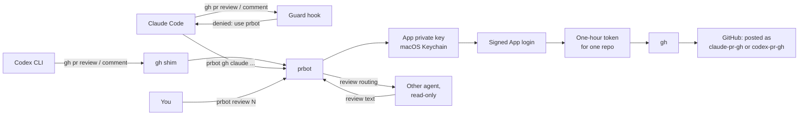

<p align="center">
  
  
  
  
</p>

# pr-review-bots

Two GitHub Apps, and the tooling around them, so that PR feedback written by Claude or Codex is posted as `claude-pr-gh[bot]` or `codex-pr-gh[bot]` instead of under Kenny's own account. A reader of any PR can then tell at a glance which comments a person wrote and which ones an agent wrote.

Everything runs locally through one command, `prbot`. It signs in as the right App, gets a token that lasts one hour and works on one repository, and runs `gh` with it. It also routes reviews: Codex reviews what Claude wrote, and Claude reviews what Codex wrote, unless you say otherwise. [`DESIGN.md`](DESIGN.md) explains the reasoning behind each choice.

## Project status

Both Apps are registered and installed on all of `kennylhilljr`'s repositories, and both have posted through `prbot` on [openclaw-ecc-orchestrator](https://github.com/kennylhilljr/openclaw-ecc-orchestrator).

| Piece | Status |
| --- | --- |
| `claude-pr-gh` and `codex-pr-gh` Apps | Live. Keys in macOS Keychain. |
| `prbot gh` (post as a bot) | Working. |
| `prbot review` with Claude reviewing | Working; posted a review on PR 20. |
| `prbot review` with Codex reviewing | Built, but not yet seen end to end. The first run stopped at a Codex usage limit. |
| Claude Code guard hook | Installed and blocking direct posts. |
| Codex CLI `gh` shim | Built and tested locally; not yet used in a live Codex session. |
| `prbot watch` (automatic reviews) | Built and dry-run against all repos. The launchd job is not installed yet. |
| `cross-review` skill | Linked into `~/.claude/skills` and `~/.codex/skills`. |
| CI (GitHub Actions) path | Not built. |

## Architecture



Reads such as `gh pr view` and `gh pr diff` always use your normal `gh` login. Only posts go through a bot.

## Requirements

| Dependency | Required | Purpose |
| --- | --- | --- |
| Python 3.9 or newer | Yes | Runs `prbot`, the guard hook and the tests. |
| `gh` (GitHub CLI) | Yes | Every read and post goes through it. Log in with `gh auth login`. |
| `openssl` | Yes | Signs the App login (RS256). |
| macOS Keychain (`security`) | Recommended | Holds the App private keys. Other systems fall back to a mode-600 file in `~/.config/prbot/`. |
| `claude` CLI | For Claude reviews | `prbot review` runs it read-only. |
| `codex` CLI | For Codex reviews | `prbot review` runs it with `-s read-only`. |

There are no third-party Python packages. The tests use the standard-library `unittest` runner.

## Install and run locally

Clone the repository into `~/Documents/GitHub`, which is where the Claude Code hook below expects it, and put `prbot` on your PATH:

```bash
git clone https://github.com/kennylhilljr/pr-review-bots.git ~/Documents/GitHub/pr-review-bots
```

```bash
ln -s ~/Documents/GitHub/pr-review-bots/prbot ~/.local/bin/prbot
```

Run the tests before first use:

```bash
cd ~/Documents/GitHub/pr-review-bots && python3 -m unittest discover -s tests -v
```

### Register the Apps (once)

`register` opens a local page that sends the App definition to GitHub. You confirm the name on GitHub's page, GitHub sends you back, and the private key goes straight into Keychain. No key file is downloaded.

```bash
prbot register claude
```

```bash
prbot register codex
```

If GitHub says a name is taken, change it on GitHub's form or edit `name` in `bots/<bot>.json` first. Then install each App on your repositories and upload its logo from `logos/` on the App's settings page; GitHub has no API for logos.

```bash
prbot install-url claude
```

Check that each App can sign in and sees its installations:

```bash
prbot whoami claude
```

### Post as a bot

Put prbot's own options before `--`, and the `gh` command after it:

```bash
prbot gh claude -R kennylhilljr/openclaw-ecc-orchestrator -- pr comment 15 --body-file review.md
```

Without `-R`, prbot uses the `origin` remote of the current directory.

### Push as a bot

Agent commits should carry the agent's identity, and the push should come from its bot. This needs the App's **Contents** permission set to read and write.

```bash
git -c user.name="Claude" -c user.email="noreply@anthropic.com" commit -m "Fix the thing"
```

```bash
prbot git claude -- push origin main
```

The token reaches `git` through a credential helper that reads it from the environment, so it never lands in git config or on disk.

### Review a PR with the other agent

```bash
prbot review 18 -R kennylhilljr/openclaw-ecc-orchestrator --route-only
```

`--route-only` prints who wrote the PR and who will review it, without running a model or posting. Drop it to run the review and post it; use `--dry-run` to run the review and print it instead. Run from a checkout of the repository when you can, so the reviewer can read files beyond the diff.

How the reviewer is chosen:

1. `--reviewer claude|codex|both` on the command line.
2. A `review:claude` or `review:codex` label on the PR.
3. Otherwise the other agent. The author comes from an `agent:claude` or `agent:codex` label, or else from commit authors and `Co-Authored-By` trailers.

If the author is unclear and nothing names a reviewer, prbot posts nothing and exits with code 3.

### Review new commits automatically

`prbot watch` makes one pass over every open, non-draft PR on every repository the bots are installed on. Each new commit gets a review from the other agent, once. A launchd job runs a pass every 5 minutes:

```bash
~/Documents/GitHub/pr-review-bots/integrations/launchd/install-watch.sh
```

How a pass behaves:

- It finds earlier reviews from the "Reviewed commit" line in each bot review, so it never reviews the same commit twice, even after a restart.
- It runs at most 3 reviews per pass; the rest wait for the next pass.
- A PR it can't attribute is skipped and logged once, with the command to review it by hand.
- A review that fails, for example on a usage limit, is retried an hour later.

Log: `~/Library/Logs/prbot-watch.log`. State: `~/.config/prbot/watch-state.json`. To see what a pass would do without posting, run `prbot watch --dry-run`. To start from now and skip the commits already open, run `prbot watch --baseline` once before installing the job. To remove the job, run `install-watch.sh --uninstall`.

## Make agents use the bots

### The `cross-review` skill

`skills/cross-review/SKILL.md` tells Claude Code and Codex how to review a PR, when to ask you, how to post replies through their own bot, and how to commit as themselves. Both agents read the same file through symlinks:

```bash
ln -s ~/Documents/GitHub/pr-review-bots/skills/cross-review ~/.claude/skills/cross-review
```

```bash
ln -s ~/Documents/GitHub/pr-review-bots/skills/cross-review ~/.codex/skills/cross-review
```

### Claude Code

Add a PreToolUse hook to `~/.claude/settings.json`:

```json
{
  "hooks": {
    "PreToolUse": [
      {
        "matcher": "Bash|mcp__.*",
        "hooks": [
          {
            "type": "command",
            "command": "f=\"$HOME/Documents/GitHub/pr-review-bots/integrations/claude-code/guard_gh_identity.py\"; [ ! -f \"$f\" ] || python3 \"$f\"",
            "timeout": 10
          }
        ]
      }
    ]
  }
}
```

The hook denies `gh pr review`, `gh pr comment`, `gh issue comment`, `gh api` writes to reviews or comments, and GitHub MCP tools that create reviews or comments, whenever they would post under your account. It also denies a plain `git push` to any repository owned by the bots' owner and points Claude at `prbot git claude -- push`; pushes to other people's repositories pass through. The denial gives Claude the exact `prbot gh claude -- ...` command to run instead. Reads pass through. If the file is missing, the hook does nothing, so it can never block every tool call; keep the path current if you move the folder.

### Codex CLI

Start Codex through the launcher, which puts a `gh` shim first on PATH:

```bash
~/Documents/GitHub/pr-review-bots/integrations/codex/codex-as-bot
```

Feedback writes go through `prbot gh codex`; every other `gh` call reaches the real `gh`.

## CLI reference

| Command | What it does | Exit codes |
| --- | --- | --- |
| `prbot register <bot> [--org ORG]` | Creates the App from `bots/<bot>.json` and stores its key. | 0, or 2 on error |
| `prbot import-key <bot> <pem> [<app_id> <owner>]` | Stores or rotates a private key. | 0, or 2 |
| `prbot install-url <bot>` | Prints the page that installs the App. | 0, or 2 |
| `prbot whoami <bot>` | Shows the App and where it is installed. | 0, or 2 |
| `prbot gh <bot> [-R owner/repo] -- <gh args>` | Runs `gh` with a one-repo App token. | `gh`'s own code, or 2 |
| `prbot git <bot> [-R owner/repo] -- <git args>` | Runs `git` (push) with a one-repo contents-write token. | `git`'s own code, or 2 |
| `prbot review <pr> [-R owner/repo] [--reviewer claude\|codex\|both] [--dry-run\|--route-only]` | Routes, runs and posts a cross-review. | 0, 2 on error, 3 when the author is unclear |
| `prbot watch [--dry-run] [--limit N] [--baseline]` | One pass of automatic reviews over open PRs. | 0, or 2 |
| `prbot classify -- <gh args>` | Used by the hook and shim. | 0 if the call posts PR feedback, else 1 |

`<bot>` is `claude` or `codex`. `<pr>` is a number or a PR URL.

## Repository layout

| Path | Contents |
| --- | --- |
| `prbot` | The CLI. Standard library only. |
| `bots/` | App name, description and logo path for each bot. |
| `logos/` | Bot logos: SVG sources and 512 px PNGs for GitHub. |
| `integrations/claude-code/` | The PreToolUse guard hook. |
| `integrations/codex/` | The `gh` shim and the `codex-as-bot` launcher. |
| `integrations/launchd/` | Installer for the job that runs `prbot watch` every 5 minutes. |
| `skills/cross-review/` | The PR review skill shared by Claude Code and Codex. |
| `AGENTS.md`, `CLAUDE.md` | Instructions for agents working on this repository. |
| `tests/` | Unit tests, including fixtures shaped like real PRs. |
| `docs/assets/` | The README header (SVG source and WebP). |
| [`DESIGN.md`](DESIGN.md) | Why it works this way. |

## Security boundaries

- App private keys live in macOS Keychain, base64-encoded under service `prbot`. Non-secret settings (App id, slug, owner) live in `~/.config/prbot/config.json`. Never commit either; `*.pem` is ignored.
- Bot tokens last one hour, cover a single repository, and exist only in the environment of one `gh` process. prbot never prints or saves them, and it clears `GITHUB_TOKEN` before calling `gh` so a personal token cannot leak into a bot post.
- Each App asks for the least it needs: read and write on pull requests and issues, read on contents and metadata. No webhooks.
- Reviewing agents run read-only: Claude with only Read, Grep and Glob and no MCP servers, Codex with `-s read-only`. They return text; only prbot posts.
- Comments that start with `@codex` stay on your account by default, because the Codex Cloud connector may ignore other bots. Set `"codex_triggers_as_bot": true` in `~/.config/prbot/config.json` once you've confirmed it responds to `claude-pr-gh`.

## Troubleshooting

### `prbot: bot 'codex' is not registered`

Run `prbot register codex`. If the App already exists on GitHub, use `prbot import-key` with a key generated on its settings page instead.

### `GitHub GET /repos/.../installation failed: HTTP 404`

The App is not installed on that repository. Open the link from `prbot install-url <bot>` and add the repository.

### `codex review failed (exit 1)` with a usage-limit message

Your Codex account is out of quota. prbot does not fall back to a Claude self-review, because that would break the cross-review rule. Wait for the limit to reset, or rerun with `--reviewer claude` if a self-review is acceptable for that PR.

### `gh` reads fail with 401, 403 or 404 inside an agent session

A `GITHUB_TOKEN` in the environment overrides your `gh` login. A fine-grained token that doesn't cover the repository causes this. Remove it from the agent's settings so `gh` uses your normal login, and check with:

```bash
gh auth status
```

### The guard blocks something you meant to post as yourself

Post it from your own terminal; the hook only applies inside Claude Code.

## Contributing

Run the tests before every change and add a regression test for every bug found; `tests/test_prbot.py` has examples built from real PR data. Keep `prbot` to the standard library. Commits written by an agent should carry that agent's identity, for example `Claude <noreply@anthropic.com>`, so GitHub attributes them to the agent rather than to you.
